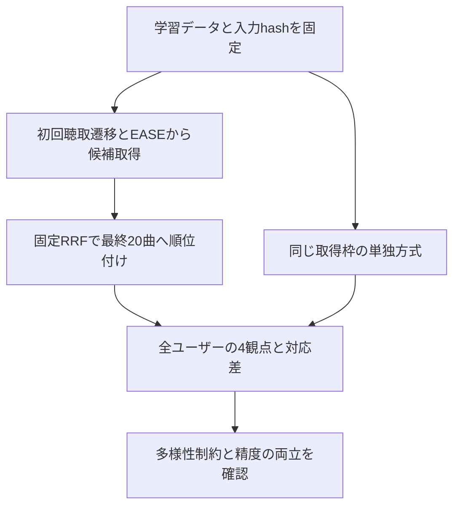

# 遷移方式の補完性と融合の比較設計

## 保存結果の診断

- [原本](../data/experiments/transition_rules/first-listen-symmetric-d5-n100/complementarity/result.json) / [CSV](../data/experiments/transition_rules/first-listen-symmetric-d5-n100/complementarity/metrics.csv) / [検算](../data/provenance/transition-complementarity-20261112/verification.json)
- 初回聴取の対称遷移・EASE binary λ500・本人履歴の時間減衰について、全119,133人の保存済み上位20曲を照合した
- 以下は90日/K20。新規精度18,601人、再聴精度19,268人。K2〜20、30/90/180日、履歴量・人気度の四分位別もCSVへ保存
- NDCG・Recall・ILD・Coverage・Novelty・計算時間の実測比較は[精度改善](accuracy-research.md)を参照。この診断は新たな推薦方式の評価ではない

| 観測 | 初回聴取遷移とEASEの新規推薦 |
| --- | ---: |
| 上位20曲の重複（全ユーザー平均） | 3.9299曲 |
| Jaccard（全ユーザー平均） | 0.124239 |
| 遷移だけが拾う正解（正解あり対象の平均） | 0.5040曲 |
| EASEだけが拾う正解（同上） | 0.4113曲 |
| 遷移単独のRecall | 3.2301% |
| EASE単独のRecall | 2.8675% |
| 両方式の候補を結合したRecall（最大40曲） | 5.2998% |

- 異なる候補を出すだけでなく、互いに独自の正解曲を含む。融合を試す根拠はあるが、融合後の上位20曲は以下の固定RRF比較で測定
- 結合Recallは候補数の増加を含む診断値で、最終20曲のRecall5.30%を達成したとは呼ばない。ユーザー別に良い方を選ぶoracleに対する候補結合の追加Recallは0.3038ポイント
- 再聴では時間減衰単独22.3247%、初回聴取遷移単独12.1809%、両候補の結合27.2468%。こちらも最大40曲の値で、時間減衰の上位20曲を置き換える根拠にはしない
- 114集計値のCPU再計算は最大差5.61e-15。200人・22,800条件の候補結合を元の正解・推薦から独立に照合。確認用の標本であり、診断母集団は全119,133人
- GPU診断179.34秒。学習・推薦生成は実行せず、外部API未使用。分析費用と推薦時の待ち時間を区別する

## 固定RRFのValidation比較



- 順位融合RRFは20曲ずつ・等重み・定数60に固定。同点は学習再生回数→曲IDで処理する
- 2方式×20曲の融合と、各単独方式40曲の取得対照を用意し、取得枠と融合方式の効果を分ける
- 最終推薦数は全方式でK2〜20。既聴除外は予測時点の学習履歴から決め、Validation/Testの正解で候補や重みを選ばない
- 新規推薦の融合を先に検証し、再聴は時間減衰を対照として別に測る。主タスク・主指標・採用版は未選択のまま保持する
- 精度が上がってもILD・Novelty低下が残る場合は、MMR等の多様性調整を一段ずつ検証する。精度改善と主観的満足度改善を混同しない
- 後半の固定条件検証とeSASRec比較は未実施。既見Testでパラメータを調整せず、独立した未使用期間の検証を別に残す
- [正規化後の遷移・EASE融合](transition-normalization.md#正規化後のease融合)は別の候補版として比較する。この未補正RRFと混ぜない

### 結果と限界

- [設定](../configs/hybrid/transition-ease.json) / [実行前記録](../data/provenance/transition-fusion-20261113/protocol.json) / [原本](../data/experiments/hybrid/transition-ease-20/result.json)
- [全指標](../data/experiments/hybrid/transition-ease-20/metrics.csv) / [対応差](../data/experiments/hybrid/transition-ease-20/paired.csv) / [共通ILD](../data/experiments/hybrid/transition-ease-20/ild.csv) / [等取得枠](../data/experiments/hybrid/transition-ease-20/pool.csv)
- 母集団は全119,133人。以下は90日/K20/日数重み1の表示条件で、採用用の主指標ではない。新規精度18,601人、再聴精度19,268人

| 指標 | 初回聴取遷移 | EASE | RRF |
| --- | ---: | ---: | ---: |
| 新規Binary NDCG | 0.041422 | 0.034995 | 0.043048 |
| 新規Recall | 3.2301% | 2.8675% | 3.3907% |
| 再聴Graded NDCG | 0.171941 | 0.105796 | 0.149573 |
| Repeat Recall | 12.1809% | 6.3716% | 10.1169% |
| 新規共通ILD | 0.605426 | 0.712475 | 0.696429 |
| 再聴共通ILD | 0.612048 | 0.625060 | 0.639867 |
| 新規Catalog Coverage | 81.0866% | 73.1738% | 78.2601% |
| 新規Novelty（bit） | 5.277246 | 5.527907 | 5.341170 |
| 学習（秒） | 114.52 | 91.09 | 205.62 |
| 順位取得・融合等（秒） | 27.17 | 43.75 | 74.05 |

- RRF−遷移の新規NDCG差は+0.001626（95%対応区間+0.000766〜+0.002458）、Recall差は+0.1606ポイント（+0.0437〜+0.2803ポイント）
- 新規NDCGの平均差が正なのは57条件中46、Recallは48。全期間・全Kで優位とはしない。区間はK20のユーザー対応bootstrapで、多重比較補正なし
- 共通ILDは新規109,145人、再聴111,223人。過去の異なる方式集合による共通ILDと母集団が異なる
- 最大40曲の融合候補Recallは5.2998%、遷移40曲は5.0580%、EASE40曲は4.9320%。融合候補−遷移40曲は+0.2417ポイント（95%対応区間+0.0972〜+0.3818ポイント）で、等取得枠でも追加の正解を含む
- 候補Recallと最終20曲Recallを区別する。取得対照の最終順位は各方式の上位20曲で、40曲を推薦した精度との比較ではない
- 再聴は遷移単独より悪化し、[時間減衰](history-combination.md)のGraded NDCG 0.375783・Repeat Recall 22.3247%にも届かない。新規・再聴の全面置換や採用判断は行わない
- RTX 3090で遷移float64、EASE float32/cuSOLVER Cholesky、融合・指標float64。seed 0、非決定性・解法差は各候補のexecutionへ保存
- 順位費用は診断用の各40曲取得を含む全238,266要求のGPU実測。RRF約0.311ms/要求はバッチ償却で、オンライン応答時間ではない。各方式の評価全体は151.23/153.14/170.16秒
- 外部API未使用。API料金・トークン・LLM/tool call・ピークメモリの未測定欄はnullを保持し、全値未測定の図は生成しない。4観点、K2〜20、30/90/180日、再生回数・日数分布を保存
- [独立検算](../data/provenance/transition-fusion-20261113/verification.json): 1,881精度値のCPU平均の最大差2.57e-15、全238,266要求のRRF順位を独立再計算して一致。母集団・出典・処理版・成果物hashを照合

## 再実行と保存容量

```bash
CUDA_PATH=/usr PYTHONUTF8=1 .venv/bin/python -m backend.interfaces.cli.hybrid --config configs/hybrid/transition-ease.json --run
CUDA_PATH=/usr PYTHONUTF8=1 .venv/bin/python -m backend.interfaces.cli.audit --output data/experiments/transition_rules/first-listen-symmetric-d5-n100/complementarity --source first-listen=data/experiments/transition_rules/first-listen-symmetric-d5-n100 --source ease=data/experiments/ease/l500 --source decay=data/experiments/history_frequency/decayed-count-30d --sort-memory-mb 2048 --no-spill
```

- 保存済み出力は上書き不可。コマンドは初回実行用で、同じ条件の再実行を暗黙に行わない
- `--sort-memory-mb`は推薦Parquetの並べ替え用メモリ上限、`--no-spill`はディスク退避禁止。対象人数を減らすオプションではない
- 容量は[研究成果の保持範囲](data-retention.md)に基づいて整理する。重要な原本を保持し、学習・一時領域・結果の必要量を確認してから実行する
- eSASRec型モデルの依存環境・容量と検証状況は[系列モデル](sequence-model.md)を参照。GPU・実データ比較は未実施
