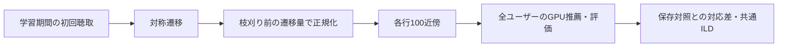

# 遷移量の正規化

## 仮説と固定条件

- 初回聴取の対称遷移は遷移回数をそのまま用いるため、頻出曲の寄与が強い。曲ごとの遷移量を補正し、新規精度・多様性への影響を検証する
- 対照は[初回聴取条件](../configs/transition_rules/first-listen.json)。追加条件は[指数0.5](../configs/transition_rules/degree-half.json)と[指数1](../configs/transition_rules/degree-one.json)の2つ
- 対称化後・近傍枝刈り前の行列Tから、出側の総和rと入側の総和cを計算し、`T[i,j] / (r[i] * c[j])**power`で正規化する
- 0.5は次数の平方根による補正、1は強い補正。cosine類似度・PCTMの再現とは呼ばない。既定0は従来と同じ
- 遷移がない曲の重みは0のまま。近傍100・位置距離5・24時間以内・本人履歴の半減期30日・同点処理は維持する
- 学習期間だけから正規化し、全学習ユーザー・全カタログを保持。Validation/Testの正解をモデルへ渡さない
- 新規Binary NDCG・Recall、再聴Graded NDCG・Repeat Recall、ILD・Coverage・Novelty、効率性を比較する。効率性以外はK2〜20。主指標・採用版は未指定
- 保存済みValidationでの追加探索として扱う。Testでの調整や独立確認済みの主張は行わない



## 初回実行

```bash
CUDA_PATH=/usr .venv/bin/python -m backend.interfaces.cli.evaluate --config configs/transition_rules/degree-half.json
CUDA_PATH=/usr .venv/bin/python -m backend.interfaces.cli.evaluate --config configs/transition_rules/degree-one.json
```

- 既存出力は上書きしない。GPU・保存容量を事前確認し、2条件を直列実行する
- CPUの独立数式とGPUの一致、正規化後の近傍順位、ゼロ次数、未来データ分離をテストする
- 全件評価の実測値は完了後のresult.jsonとmetrics.csvを参照。未完了の保存物を結果として扱わない

## Validationの結果

- [事前固定](../data/provenance/transition-normalization-20261113/protocol.json) / [補正0.5原本](../data/experiments/transition_rules/first-listen-degree-half/result.json) / [補正1原本](../data/experiments/transition_rules/first-listen-degree-one/result.json)
- [全指標](../data/experiments/transition_rules/first-listen-degree-one/comparison/metrics.csv) / [対応差](../data/experiments/transition_rules/first-listen-degree-one/comparison/paired.csv) / [共通ILD](../data/experiments/transition_rules/first-listen-degree-one/comparison/ild.csv) / [独立CPU検算](../data/provenance/transition-normalization-20261113/verification.json)
- 全119,133人。90日/K20/日数重み1の表示条件で、新規精度18,601人・再聴精度19,268人。主指標や採用条件ではない

| 指標 | 未補正 | 補正0.5 | 補正1 |
| --- | ---: | ---: | ---: |
| 新規Binary NDCG | 0.041422 | 0.059622 | 0.035800 |
| 新規Recall | 3.2301% | 4.4257% | 2.8417% |
| 再聴Graded NDCG | 0.171941 | 0.224002 | 0.201097 |
| Repeat Recall | 12.1809% | 14.4261% | 14.0597% |
| 新規共通ILD（14,482人） | 0.563651 | 0.611147 | 0.685399 |
| 再聴共通ILD（87,648人） | 0.611494 | 0.634625 | 0.665729 |
| 新規Catalog Coverage | 81.0866% | 99.4290% | 99.4683% |
| 新規Novelty（bit） | 5.277246 | 6.584618 | 9.250813 |

- 補正0.5−未補正の新規NDCG差+0.018200（95%対応区間+0.016916〜+0.019499）、Recall差+1.1957ポイント（+1.0671〜+1.3285ポイント）。両指標の平均は全57条件で改善
- EASE比のNDCG差+0.024627、Recall差+1.5583ポイント。区間はそれぞれ+0.022858〜+0.026460、+1.3650〜+1.7582ポイント
- 再聴も未補正より改善したが、時間減衰のNDCG0.375783・Recall22.3247%には届かない。全タスクの全面置換とはしない
- 補正1は新規精度を悪化させた。希少曲の推薦が増え、新規ILDを算出できる人は14,861人に減少。5方式共通の14,482人によるILDを全員の多様性と解釈しない
- 補正0.5の入力準備・学習115.71秒、全238,266要求のGPU順位取得28.09秒、評価全体125.38秒。約0.118ms/要求はバッチ償却で、オンライン待ち時間ではない
- RTX 3090、CUDA疎行列・float64・seed 0。非決定性はexecutionへ記録。外部API未使用、未測定料金・token・callはnullを保持
- 2条件の計1,254精度値をCPU再計算（最大差3.72e-15）。40対応条件・2,000再標本化の区間も独立検算（最大差3.47e-15）、全員の母集団と入力・成果物hashを照合
- 追加比較は[補正0.5とEASEの固定融合](../configs/hybrid/degree-half-ease.json)と、補正0/0.5を変えずに後半期間へ適用する検証。[実行前記録](../data/provenance/normalized-followup-20261113/protocol.json)に条件を保持し、Testの結果で調整しない

## 正規化後のEASE融合

- [原本](../data/experiments/hybrid/degree-half-ease-20/result.json) / [対応差](../data/experiments/hybrid/degree-half-ease-20/paired.csv) / [共通ILD](../data/experiments/hybrid/degree-half-ease-20/ild.csv) / [等取得枠](../data/experiments/hybrid/degree-half-ease-20/pool.csv)
- [従来の固定RRF](transition-fusion.md)と同じく20曲ずつ・等重み・定数60、単独40曲取得を対照にする。以下は90日/K20/日数重み1

| 指標 | 補正0.5単独 | 補正0.5＋EASE |
| --- | ---: | ---: |
| 新規Binary NDCG | 0.059622 | 0.053068 |
| 新規Recall | 4.4257% | 4.3086% |
| 再聴Graded NDCG | 0.224002 | 0.179517 |
| Repeat Recall | 14.4261% | 11.9205% |
| 新規共通ILD（83,432人） | 0.647993 | 0.710706 |
| 再聴共通ILD（100,935人） | 0.639392 | 0.654711 |
| 新規Catalog Coverage | 99.4290% | 97.5636% |
| 新規Novelty（bit） | 6.584618 | 6.006677 |
| 学習（秒） | 114.43 | 206.03 |
| 順位取得・融合等（秒） | 28.11 | 74.95 |

- 融合−単独の新規NDCG差−0.006554（95%対応区間−0.007519〜−0.005505）。Recall差−0.1172ポイント（−0.2352〜+0.0013ポイント）で、Recall区間は0を含む
- 最大40曲の融合候補Recall6.4868%に対し、正規化遷移40曲は6.6209%。差−0.1341ポイントの区間は−0.2791〜+0.0148ポイントで、等取得枠での改善は確認できない
- 共通ILDは改善するが、表示条件の精度向上策とはしない。未補正で有効だった融合が、強化後の候補にも有効とは限らない
- 全119,133人・4観点・全K/期間/日数重みを保存。遷移float64、EASE float32/cuSOLVER Cholesky、融合・指標float64、seed 0。バッチ償却費用でありオンライン待ち時間ではない
- [1,881精度値と全238,266要求のRRF順位検算](../data/provenance/normalized-followup-20261113/fusion-verification.json) / [12対応条件・2,000再標本化の区間検算](../data/provenance/normalized-followup-20261113/fusion-interval-verification.json)を通過。外部API未使用、未測定値はnull

## 固定条件の後半期間

- [未補正原本](../data/experiments/transition_rules/first-listen-symmetric-d5-n100/test/result.json) / [補正0.5原本](../data/experiments/transition_rules/first-listen-degree-half/test/result.json) / [対応差](../data/experiments/transition_rules/first-listen-degree-half/test/comparison/paired.csv) / [共通ILD](../data/experiments/transition_rules/first-listen-degree-half/test/comparison/ild.csv)
- 2018-09-21を予測時点とし、Train＋Validationだけで再学習。全119,133人・53,336曲を保持し、指数0/0.5以外の条件は同じ。Testで係数・近傍・半減期を調整しない
- 以下は90日/K20/日数重み1。新規精度14,069人、再聴精度14,594人。既見Testの探索的追加評価であり、未使用期間の独立確認ではない

| 指標 | 未補正 | 補正0.5 |
| --- | ---: | ---: |
| 新規Binary NDCG | 0.037030 | 0.061087 |
| 新規Recall | 2.5212% | 3.8265% |
| 再聴Graded NDCG | 0.168269 | 0.237616 |
| Repeat Recall | 10.4442% | 12.8439% |
| 新規共通ILD（79,549人） | 0.584162 | 0.642965 |
| 再聴共通ILD（90,472人） | 0.610499 | 0.635207 |
| 新規Catalog Coverage | 77.9530% | 99.3382% |
| 新規Novelty（bit） | 5.249997 | 6.575158 |

- 新規NDCG差+0.024057（95%対応区間+0.022603〜+0.025565）、Recall差+1.3053ポイント（+1.1804〜+1.4359ポイント）。両指標の平均は全57条件で未補正より高い
- 共通ILDは未補正・補正0.5・EASE・時間減衰の4方式共通対象。Validationの5方式共通ILDとは分母が異なる。特徴の欠測を0で補わない
- 再聴も未補正より改善したが、時間減衰のNDCG0.415465・Recall20.1585%を下回る。再聴の対照は維持する
- 補正0.5の入力準備・学習130.43秒、全238,266要求のGPU順位取得31.93秒、評価全体130.50秒。約0.134ms/要求はバッチ償却。外部API未使用、未測定値はnull
- [独立検算](../data/provenance/normalized-followup-20261113/later-verification.json): 計1,254精度値のCPU平均は最大差3.55e-15、24対応条件・2,000再標本化の区間は最大差2.25e-15。母集団・学習出典・処理版・成果物hashを照合
- **指数0.5の正規化による新規精度改善は両期間で再現した。補正1や等重み融合では補正0.5からの追加精度改善を確認できず、独立期間・オンライン効果・総合採用は未確定**。系列モデルとの比較は[次の研究課題](accuracy-research.md#優先3-esasrecによる系列学習)

```bash
CUDA_PATH=/usr .venv/bin/python -m backend.interfaces.cli.evaluate --config configs/transition_rules/degree-half.json --phase test
CUDA_PATH=/usr .venv/bin/python -m backend.interfaces.cli.hybrid --config configs/hybrid/degree-half-ease.json --run
```

- 上記は初回実行用。保存済み出力へ再実行しない。比較の参照条件は各comparison/config.jsonに保存する
