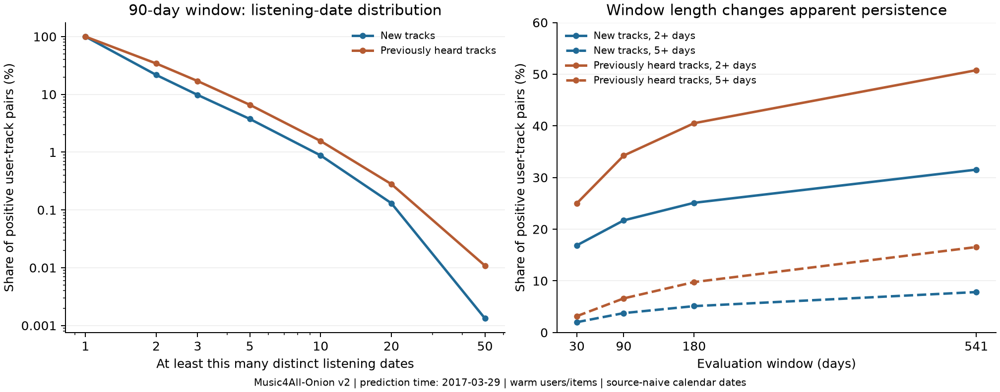

# GroundTruth：再生回数・再生日数と評価期間の検討

- 実行日：2026-10-14。対象はMusic4All-Onion v2のTrain／Validation全量。モデルの学習・推薦性能評価は行っていない。
- 合意済みの3観点は[評価方針](../../docs/evaluation-protocol.md)、一次資料の整理は[方法メモ](ground-truth-methods.md)。以下の期間・関連度式は今回の分析からの**提案であり、未確定**。
- 集計結果：[JSON](eda/ground-truth-profile.json)、[分布図](eda/ground-truth-distributions.png)、[再現用スクリプト](eda/ground_truth_profile.py)。共有集計にはユーザーID・楽曲IDを含めない。

## 集計条件

| 項目 | 条件 |
| --- | --- |
| 推薦時点 | 2017-03-29 00:00:00 |
| Train | 推薦時点より前の202,396,019イベント。119,133ユーザー・45,888曲 |
| Validation | 推薦時点から2018-09-21 00:00:00未満の25,281,875イベント |
| 窓 | 同じ推薦時点から30・90・180日とValidation全期間541日。終了時刻は含めない |
| 新規 | Trainで本人は未聴。ユーザー・曲はTrainで観測済み |
| 既聴 | Trainで本人が再生済み。ユーザー・曲はTrainで観測済み |
| 分布の単位 | その期間に1回以上再生されたユーザー×曲の組。再生回数は行数、再生日数は異なる日付の数 |
| 日境界 | 配布日時の暦日。タイムゾーン未確認のためUTC・JSTへ変換しない |
| 分位点 | 正確な離散分位点`quantile_disc`。ユーザー平均とは別 |
| Test | 入力ファイル全体のSHA-256検証は実施。Test期間のイベントは集計・閾値検討に使用していない |

再生行の重複を勝手に削除せず、配布イベントの出現回数を保持した。同一日内の多数再生は回数には反映され、日数には1日として反映される。非再生の理由、自発的な再生と自動再生、ユーザーごとのログ取得終了はこのデータだけでは特定できない。

## 分布

| 対象 | 正のユーザー×曲数 | 再生回数：中央値 / 90%点 / 99%点 / 最大 | 再生日数：中央値 / 90%点 / 99%点 / 最大 |
| --- | ---: | --- | --- |
| Train全期間 | 42,582,802 | 2 / 10 / 46 / 28,069 | 2 / 8 / 32 / 1,507 |
| Validation 90日・新規 | 603,121 | 1 / 3 / 15 / 2,465 | 1 / 2 / 9 / 57 |
| Validation 90日・既聴 | 1,215,238 | 1 / 4 / 17 / 5,843 | 1 / 4 / 12 / 90 |

- Trainは長年の履歴、Validationは90日の観測なので、両者の回数・日数を同じ観測量として比較しない。
- 90日窓の100回以上再生された組は新規184・既聴288の計472組。そのうち1日だけの再生は計6組。多数回再生は大半が複数日の観測でもあり、情報として捨てる理由はない。一方、最大値は大きく、生回数を関連度に直結させる設計は慎重に扱う。
- 90日窓で`log2(1+回数)`と`log2(1+日数)`の相関は新規0.912・既聴0.933。回数と日数は独立した根拠ではなく、加算すると両者が共有する反復再生の情報も重くなる。

## 評価期間で何が変わるか

割合は各窓で1回以上再生された、該当カテゴリのユーザー×曲を分母とする。

| 窓 | 新規の正解保有ユーザー | 既聴の正解保有ユーザー | 新規：2日以上 / 5日以上 | 既聴：2日以上 / 5日以上 |
| --- | ---: | ---: | --- | --- |
| 30日 | 14,744 | 16,460 | 16.87% / 2.00% | 25.00% / 3.17% |
| 90日 | 18,601 | 19,268 | 21.71% / 3.76% | 34.25% / 6.60% |
| 180日 | 20,702 | 20,876 | 25.11% / 5.11% | 40.51% / 9.76% |
| 541日 | 23,914 | 23,707 | 31.53% / 7.83% | 50.77% / 16.54% |

- 窓を延ばすだけで複数日再生の割合が増える。異なる窓の指標差を推薦モデルの改善とは解釈しない。窓ごとに観測されるユーザー・曲の構成も変わるため、純粋な期間長の因果効果を測った比較ではない。
- 90日窓の正解保有ユーザーはTrainユーザー全体の新規15.61%・既聴16.17%。正解なしユーザーを除く精度平均だけでは母集団全体を表さないので、対象人数・除外人数も必ず併記する。
- ユーザー×曲を等重みで集計した90日の2日以上割合は新規21.71%・既聴34.25%。正解保有ユーザー内で先に割合を計算して平均すると20.08%・25.77%。活動量の大きいユーザーへの偏りがあるので、評価指標はユーザー単位の平均を基本候補とする。
- 2日以上は層別に使える規模がある。5日以上は90日窓で新規3.76%に絞られるため、全正解をこの条件で切り捨てる主評価は推奨しない。

## 新規曲の初回から30日間をそろえた補助集計

各窓の新規曲について、初回日から30暦日を窓内で確保できる組だけを対象とした。初回日を含む30暦日を数え、初回日以外にも再生があれば「2日以上」に入る。期間末の初回曲は再聴なしと判定せず、追跡不足として分けた。

| 評価窓 | 30暦日を確保できる組 | 期間末で対象外の組 | 対象組での2日以上割合 |
| --- | ---: | ---: | ---: |
| 30日 | 7,979 | 206,900 | 21.59% |
| 90日 | 421,685 | 181,436 | 20.77% |
| 180日 | 952,562 | 155,849 | 19.93% |
| 541日 | 2,738,233 | 136,698 | 19.15% |

- 90日窓でも新規曲の30.08%は30暦日を確保できない。30日評価窓では対象が初日発見曲だけに偏る。
- これは**暦の上で追跡窓が収まる**という条件。実際にユーザーのログが30日間取得され続けた保証ではない。ユーザーの最終再生を観測終了の確定値として使っていない。
- 対象が初回時期で選ばれるため、窓同士で同じ曲・ユーザーのコホートではない。表の割合の大小を定着性能の差とは解釈しない。
- 推薦の提示・露出が記録されていないため、推薦によって曲が定着した因果効果や、推薦された曲のretentionを測った結果ではない。期間内Graded NDCGとは分けた記述統計である。[一次資料と適用上の区別](ground-truth-methods.md)

## 推奨する次の評価案（未確定）

### 期間

- **主評価90日、期間の感度分析30日・180日**を候補にする。90日でも新規・既聴それぞれ約1.9万人に正解があり、541日の長期予測より短い観測窓で比較できる。統計だけで90日が最適と証明されたわけではない。
- Validation候補は`[2017-03-29, 2017-06-27)`。既存の学習境界は変更せず、Train全期間を共通の学習入力にする。期間感度分析でも同じ推薦時点のランキングを使う。
- Testも採用した日数を元のTest開始時点から適用する案とし、モデルは従来どおり元のTrain＋Validationで学習する。Testの新条件の集計・評価は今回行っていない。既存の全期間評価と新90日評価の結果は別条件として保存する。541日は既存Validationの窓を指す。
- 初回からの30暦日追跡は補助分析候補として分ける。主評価のGraded NDCGを追跡可能な組だけに限定しない。補助分析の対象外の曲を、ランキングから削除して詰め直さない。

### 関連度と指標

`n`を評価期間の再生回数、`d`を異なる再生日数とする。

| 対象 | 主な計算の候補 |
| --- | --- |
| 新規発見 | `n >= 1`を正解とするBinary NDCG・Recall |
| 既聴曲の再聴 | Graded NDCGと、`学習で既聴かつn >= 1`を正解とするRepeat Recall |
| 新規曲の定着 | 新規発見と同じランキングを、評価期間の回数・日数によるGraded NDCGで評価。定着の代理指標と明記 |

- Graded NDCGのgain候補は`g(n,d) = log2(1+n) + λ × log2(1+d)`。**λ=1を初期案**、λ=0・0.5・2を重みの感度分析候補とする。再生なしは0。日数を増やすことと同日内で回数を増やすことの両方を反映し、回数の突出を圧縮する。これは実際の好みを直接測定した値ではない。
- このgainをDCGの位置割引に直接使い、さらに`2^g-1`へ変換しない。IDCGは各ユーザーの対象候補集合にある全正解から計算し、返却された20曲だけから作らない。[gainの確認](ground-truth-methods.md#graded-ndcgはgainまで指定する)
- 1日だけ／2〜4日／5日以上を補助層別として併記する案。主評価の正解を5日以上だけに絞らない。連続gainを使う場合、0・1・2・3の離散関連度への変換は必須ではない。
- 回数と日数の相関が高いので、加算式やλ=1を正解と断定しない。関連度の定義を「特定モデルの数値が最もよくなる」ように選ばず、研究目的を説明できるルールとして固定し、感度を示す。
- 正解なしユーザーは精度平均の対象外とし人数を別記する案。推薦失敗は正解がある要求では0、短いランキングは返った位置のまま評価し、件数・失敗率を示す。多様性・効率性の集計対象を精度の正解有無だけで削らない。
- K=10を主評価、K=5・20を補助、K=2〜20を感度分析とする。新規・既聴の2ランキングを生成し、新規発見と新規定着は同じ新規ランキングを使う。
- ILDの距離表現・空タグ／欠損の扱い、Coverageの分母、Noveltyの学習人気度は別途定義が必要。今回の分布からは確定できない。

## 検証・保存

- 元ParquetのSHA-256は`f12cffed51730afd4ba527baae4bcc025236577ebe5a0b6c31d5240808666cfa`。保存済み変換manifestと一致。入力の内容hash・境界・処理ソースhashは集計JSONに記録。
- 合成9イベントで、Train／Validation／Test境界、同日内の重複再生、異なる再生日、cold user / cold itemの分類、固定30日追跡、分割書出しでTestが入らないことを確認した。
- Train合計202,396,019、Validation合計25,281,875を既存EDAと照合。Validation全期間の新規2,874,931組・既聴3,326,807組・cold user 207組・cold item 1,060,658組も一致。全対象で`1 <= 再生日数 <= 再生回数`とカテゴリ合計を確認した。
- 全件を一度に集計する初回処理は2GB上限で停止した。ユーザーのhashで32分割し、各分割を2GB・2スレッドで処理して完了した。統計は標本抽出や近似分位点ではない。2GBはDuckDBの設定であり、プロセス全体のメモリ上限ではない。
- 分割ファイルとユーザー×曲集計、実行時の元コードは`data/ground-truth-eda/20261014-partitioned-v2/`に保存（Git管理外）。再現用スクリプトはルートと出力先の指定を移植可能にして整形したもの。実行時コードのhashと再現用コードのhashは別々に記録している。
- 再実行：`.venv/bin/python experiments/music4all/eda/ground_truth_profile.py --output data/ground-truth-eda/新しい実行名`。合成確認のみなら`--self-check`。既存出力ディレクトリは上書きしない。
- DB・Evaluator・保存済みsnapshot / splitは変更していない。コミット・pushは行っていない。
